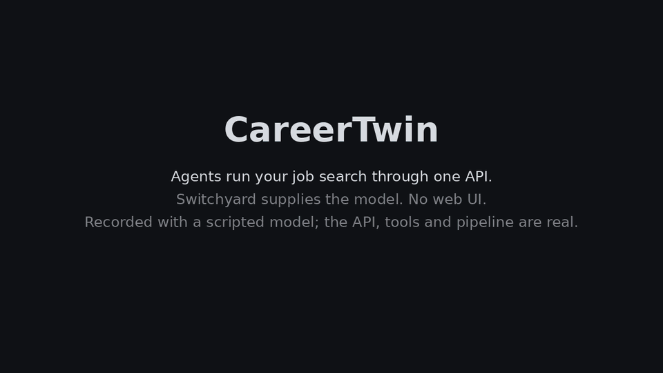

<div align="center">

# CareerTwin

**Agents run your job search through one API. Switchyard supplies the model.**

[](https://www.python.org/)
[](docs/AGENTS.md)
[](LICENSE)



*About 50 seconds: the API, the tool catalogue, an agent that is stopped before it applies, and the interview assistant.
The language model is scripted so the recording is repeatable; the API, tools and pipeline are real.*
[Watch as MP4](docs/media/demo.mp4)

</div>

## What it does

- **Finds and ranks vacancies.** A search agent reads job feeds, search indexes and company career boards,
  and a decision model scores each vacancy against the facts in your `ABOUT.md`.
- **Prepares and sends applications.** It writes a tailored CV and cover letter from those same facts,
  fills the form in your signed-in Chrome, and tracks every step in SQLite and an Excel workbook.
  It stops at login, CAPTCHA and any question it cannot answer from your profile.
- **Helps in live interviews.** A compact window transcribes the call on your machine and writes what to
  say, in first person, built only from your real experience: your `ABOUT.md`, the CV you sent and the
  vacancy, in the language of the interview. Before the call it builds a question bank and reviews your CV
  against the vacancy. Documents, language, audio, model and screenshots are all set in the window's Settings.
- **Is driven by agents, not a web page.** There is no web UI. Every capability is an HTTP endpoint and a
  typed tool, served over MCP to Claude Code, Codex, OpenCode or the built-in agent.

## Quick start

```bash
git clone https://github.com/kravchenski/careertwin.git && cd careertwin
cp .env.example .env                 # point SWITCHYARD_* at your gateway
cp ABOUT.example.md ABOUT.md         # then fill in your real background
uv sync --extra rendering

switchyard                           # your model gateway, http://127.0.0.1:3260
uv run careertwin serve              # the API, http://127.0.0.1:8000  (docs at /docs)
uv run careertwin agent "Find strong Python matches and prepare CVs for the top two"
```

The `careertwin*` commands live in the project's virtualenv: run them with `uv run`, or activate it
(`source .venv/bin/activate`, or `activate.fish` in fish).
Browser steps need the [Switchyard extension](https://github.com/kravchenski/switchyard-extension) in the
Chrome you are signed in to. Python 3.14 and [uv](https://docs.astral.sh/uv/) are required.

## Install as an app (CachyOS and other Arch-based systems)

```bash
./scripts/install.sh          # or: make install
careertwin-interview          # from any directory, or open "CareerTwin Interview" in your launcher
```

This puts `careertwin-interview`, `careertwin` and `careertwin-mcp` in `~/.local/bin` and adds a launcher
entry with an icon. The install is editable, so it runs the code of this checkout and a `git pull` takes
effect at once; run the script again when dependencies change. `./scripts/uninstall.sh` removes it and
keeps your data. It needs `uv` and `libpulse` (`parec`, `pactl`); `grim` is optional for screenshots.

## The three ways in

| | Command | Guide |
|---|---|---|
| **An agent on Switchyard** | `uv run careertwin agent` or `claude mcp add careertwin -- uv run careertwin-mcp` | [docs/AGENTS.md](docs/AGENTS.md) |
| **The interview window** | `uv run --extra interview careertwin-interview` | [docs/INTERVIEW.md](docs/INTERVIEW.md) |
| **The HTTP API** | `uv run careertwin serve`, then `http://127.0.0.1:8000/docs` | [docs/AUTOMATION.md](docs/AUTOMATION.md) |

```
 Claude Code · Codex · OpenCode · careertwin agent
        │ model calls                    │ tool calls (MCP)
        ▼                                ▼
 Switchyard :3260  ◄── browser tools ──  CareerTwin API :8000 ──► SQLite · data/outputs · Excel
 (providers, auto routing, /mcp)         search · rank · prepare · apply · track · interview
```

## Safe by default

- **Nothing is sent without you.** `submit_application` needs `confirm=true`, `CAREERTWIN_AGENT_ALLOW_SUBMIT=1`
  and, in the built-in agent, your yes at a prompt. Agents cannot turn on auto-submit or scheduling.
- **Facts only.** CVs, cover letters, form answers and interview hints come from `ABOUT.md`. If it has nothing
  on a topic, the answer says so instead of inventing experience.
- **A fit score is not a hiring probability.** It measures compatibility with the written requirements.
- **Your data stays local.** `ABOUT.md`, `data/` and transcripts are git-ignored; interview audio is never stored.

## The document library

Before the agents there is a library that turns your background into documents: a career knowledge graph
parsed from a CV, GitHub and your website, nine PDF templates, an ATS checker, a vision model that
inspects the rendered page, and a repair loop. It has its own CLI (`careertwin build`, `tailor`, `cover`,
`match`, `gaps`, `render`, `qa`, `repair`) and powers the CV step of the application agent.
See [docs/DOCUMENTS.md](docs/DOCUMENTS.md).

## Project layout

```
src/careertwin/
├── api/            FastAPI app, request models, one route module per feature
├── agentic/        the tool catalogue, MCP server and the Switchyard agent loop
├── automation/     the four application agents: search, rank, documents, browser, tracking
├── interview/      live interview assistant: audio, Whisper, question detection, coach, Qt overlay
├── jobs/           vacancy discovery: ATS adapters (boards/), scanners, career pages, companies.json
├── profile/        ABOUT.md context, career graph building, profile names
├── services/       resume tailoring used by the API
├── agents/ ats/ collectors/ graph/ rendering/ storage/ templates/ vision/    the document library
└── settings.py  db.py  llm.py  browser.py  net.py  cli.py
docs/               AGENTS · AUTOMATION · INTERVIEW · DOCUMENTS · ARCHITECTURE
docker/             Dockerfile and supervisor config for the API container
scripts/            company link checker, overlay preview, demo recorder
tests/              pytest suite (no network, no real applications)
```

[docs/ARCHITECTURE.md](docs/ARCHITECTURE.md) explains how the layers fit and how a vacancy moves through them.

## Configuration

Copy `.env.example` to `.env`. The important variables:

| Variable | Purpose | Default |
|---|---|---|
| `SWITCHYARD_URL` | Gateway for text generation, decisions and agents | `http://127.0.0.1:3260` |
| `SWITCHYARD_MODEL` | Default model id (`auto` routes across your providers) | `agent` |
| `SWITCHYARD_AGENT_MODEL` | Model for `careertwin agent` | falls back to `SWITCHYARD_MODEL` |
| `SWITCHYARD_MCP_URL` | Gateway browser tools | `http://127.0.0.1:3260/mcp` |
| `SWITCHYARD_API_KEY` | Bearer token when the gateway needs one | empty |
| `CAREERTWIN_API_URL` | Where agent tools reach the API | `http://127.0.0.1:8000` |
| `CAREERTWIN_AGENT_ALLOW_SUBMIT` | `1` lets an approved agent press submit | empty |
| `INTERVIEW_MODEL`, `CAREERTWIN_WHISPER_MODEL` | Interview hints model, Whisper size | `auto`, `small` |
| `CAREERTWIN_DATA_DIR` | Database, outputs, cache, transcripts | `./data` |
| `SEARXNG_URL`, `TAVILY_API_KEY` | Web search for vacancy discovery | `http://localhost:8888` |

## Development

```bash
uv sync --extra dev --extra rendering --extra interview
uv run pytest -m "not integration"      # no network, no live applications
uv run ruff check src tests
docker compose up --build               # API + SearXNG in containers
```

The interview extra pulls Qt and faster-whisper (large); everything else works without it.
Conventions are in [CONTRIBUTING.md](CONTRIBUTING.md).

## License

Apache 2.0, see [LICENSE](LICENSE).
