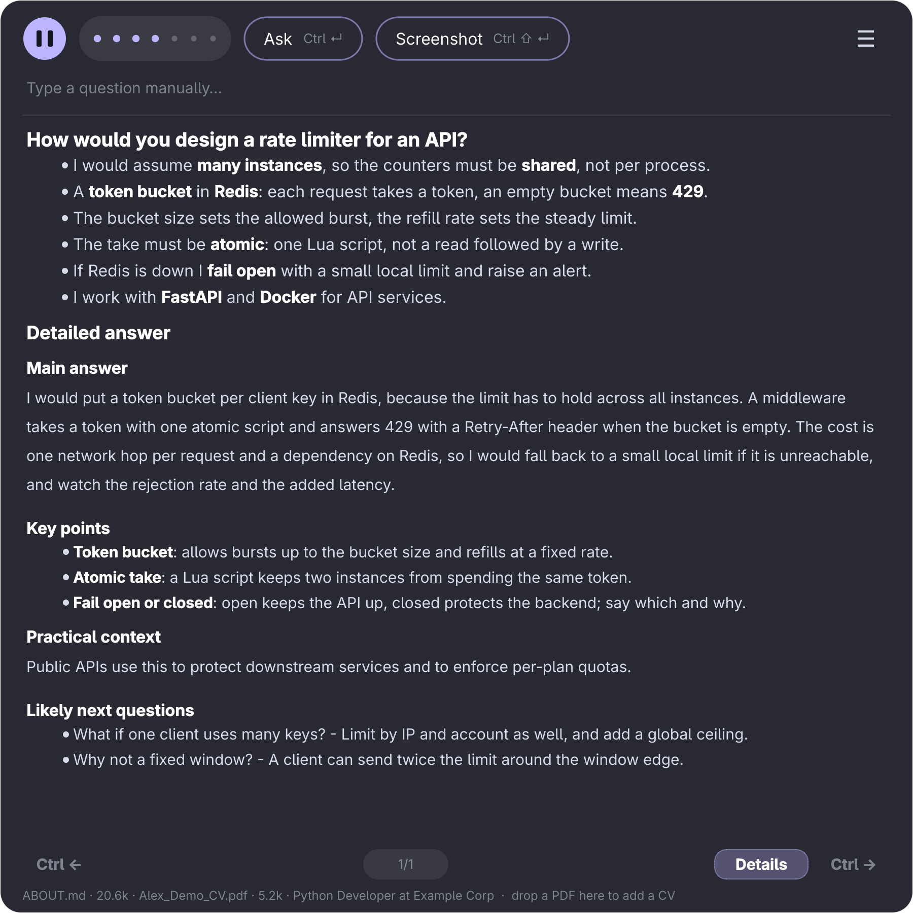
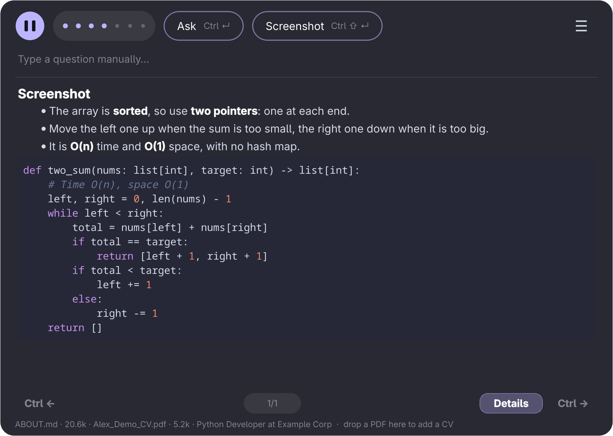
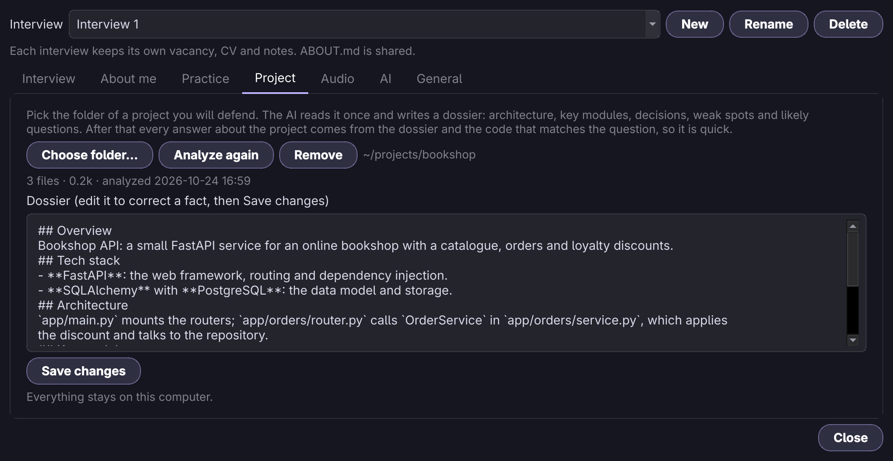
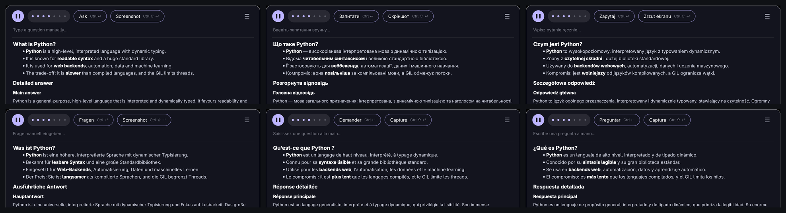
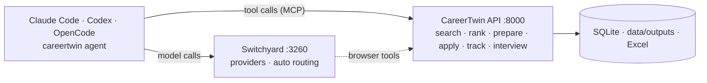
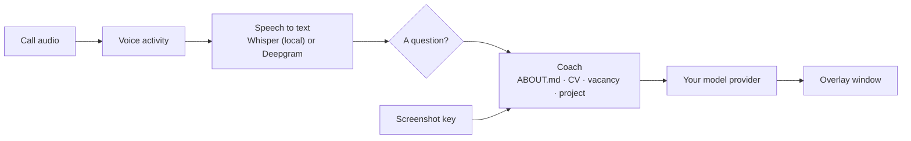

<div align="center">

# CareerTwin

**Your career as an API that agents can use, and a live interview copilot that only says what is true about you.**

[](https://github.com/kravchenski/careertwin/actions/workflows/tests.yml)
[](https://github.com/kravchenski/careertwin/actions/workflows/release.yml)
[](https://www.python.org/)
[](docs/AGENTS.md)
[](#platform-support)
[](LICENSE)
[](https://docs.astral.sh/ruff/)

[Quick start](#quick-start) · [Interview assistant](#the-interview-assistant) · [Agents and MCP](#agents-and-mcp) · [Platforms](#platform-support) · [Docs](#documentation) · [Contributing](#contributing)


*About 50 seconds: the API, the tool catalogue, an agent that is stopped before it applies, and the interview assistant.
The language model is scripted so the recording is repeatable; the API, tools, speech recognition and window are real.*
[Watch as MP4](docs/media/demo.mp4)

</div>

## Why CareerTwin

- **One source of truth.** You write down what is true about you once, in `ABOUT.md`. CVs, cover letters, form
  answers and interview hints are all built from it, and when it has nothing on a topic the answer says so instead
  of inventing experience.
- **Agent-native.** There is no web UI to click through. Every capability is an HTTP endpoint and a typed tool,
  served over MCP to Claude Code, Codex, OpenCode or the built-in agent.
- **Local first.** Your files stay on your machine. Speech is recognised locally by default, interview audio is
  never stored, and the one thing that leaves is text sent to the model provider *you* chose.
- **Safe by default.** Nothing is sent to an employer without three separate confirmations.

## What you get

| | What it does | Guide |
|---|---|---|
| **Job-search agents** | Find and rank vacancies against your facts, write a tailored CV and cover letter, fill the application in your signed-in Chrome, track every step in SQLite and an Excel workbook. Stops at login, CAPTCHA and any question it cannot answer from your profile. | [docs/AUTOMATION.md](docs/AUTOMATION.md) |
| **Interview assistant** | A compact window that transcribes the call and writes what to say, in first person, from your real experience. Solves a task from a screenshot, defends a project from its code, speaks seven languages. | [docs/INTERVIEW.md](docs/INTERVIEW.md) |
| **MCP server and HTTP API** | 29 typed tools and a documented REST API that any agent or script can drive. | [docs/AGENTS.md](docs/AGENTS.md) |
| **Document library** | A career knowledge graph, nine PDF templates, an ATS checker, a vision-based quality check and a repair loop. | [docs/DOCUMENTS.md](docs/DOCUMENTS.md) |

## Quick start

**Download** (interview assistant): the [latest release](https://github.com/kravchenski/careertwin/releases/latest)
has a Windows setup program, a portable Windows zip and a macOS disk image (Apple silicon). Neither installer is
signed, so Windows may say the publisher is unknown (More info, Run anyway) and macOS wants a right-click, Open the
first time.

**Linux** (CachyOS and other Arch-based systems):

```bash
git clone https://github.com/kravchenski/careertwin.git && cd careertwin
./scripts/install.sh          # or: make install   (uv, libpulse; grim is optional for screenshots)
careertwin-interview          # or open "CareerTwin Interview" in your launcher
```

**From source**, for the agents and the API:

```bash
git clone https://github.com/kravchenski/careertwin.git && cd careertwin
cp .env.example .env                 # point SWITCHYARD_* at your gateway
cp ABOUT.example.md ABOUT.md         # then fill in your real background
uv sync --extra rendering

switchyard                           # your model gateway, http://127.0.0.1:3260
uv run careertwin serve              # the API, http://127.0.0.1:8000 (token in data/api-token)
uv run careertwin agent "Find strong Python matches and prepare CVs for the top two"
```

Python 3.14 and [uv](https://docs.astral.sh/uv/) are required; the `careertwin*` commands live in the project's
virtualenv, so run them with `uv run` or activate it. Browser steps need the
[Switchyard extension](https://github.com/kravchenski/switchyard-extension) in the Chrome you are signed in to.

## The interview assistant

<p align="center"></p>

A frameless window that sits on top of your call. It listens to the interviewer, recognises a question, and writes
what *you* could say, line by line, built only from your `ABOUT.md`, the CV you sent and the vacancy.

- **Hears the call, locally.** Voice-activity detection and Whisper run on your machine (the GPU when there is
  one); Deepgram is an opt-in cloud alternative. Questions are recognised in seven languages even when the
  transcript has no question mark, and other languages are answered too.
- **Answers technical questions the way an engineer would.** A concept, a design, a slow endpoint or a function to
  write each gets its own shape: definition and trade-off, assumptions and bottleneck, reproduce-measure-narrow-fix,
  approach with complexity and then the code. General knowledge is never passed off as your experience, and the
  detailed answer ends with the questions the interviewer will probably ask next.

  <p align="center"></p>
- **Solves what is on the screen.** Press `Ctrl+Shift+Enter` (a key bound in your compositor on Linux, built in on
  Windows) and the window answers the task you are looking at: the approach in a few lines and the solution as code;
  for a multiple-choice quiz the right option, for "what does this print" the traced output, for a bug the fixed code.

  <p align="center"></p>

- **Defends your project.** Point *Settings → Project* at a folder. The AI reads it once and writes a dossier;
  from then on every answer about the project comes from the dossier and the code that matches the question.
  Secrets and binaries are never read, and a cloud provider is asked before anything is sent.

  <p align="center"></p>

- **Prepares you before the call.** A question bank for the vacancy, each question with first-person lines to say,
  and a review of your CV against the vacancy.
- **Any model, any language.** Switchyard, Groq, OpenAI, OpenRouter, Ollama, LM Studio or your own OpenAI-style
  address; a separate fast model for screenshots. The window speaks English, Russian, Polish, Ukrainian, German,
  French and Spanish, and a new language is one JSON file ([docs/TRANSLATING.md](docs/TRANSLATING.md)).

<p align="center"></p>

<p align="center"></p>

### How fast is it

Measured on one real setup (a laptop with an RTX 4050, models through a local Switchyard); your numbers depend on
your hardware and provider.

| Step | Time |
|---|---|
| Screen capture and JPEG encode | about 30 ms |
| A screenshot answered by a fast vision model (`qwen3.8-27b` on Groq) | 0.8 to 2.2 s, start to finish |
| The same screenshot on most free vision models | 4 to 30 s |
| A 9-second spoken question, from the end of speech to its text being ready | about 1 s on the GPU, 1.9 s on the CPU |
| A project question, finding the matching code | 0.5 ms for a small project, about 4 ms for the largest one it reads (6 MB of text); the model is the rest |

The model is almost always the slow part, so the window lets you pick one for screenshots and shows how long the
last answer took. Details and method: [docs/INTERVIEW.md](docs/INTERVIEW.md).

### Use it fairly

Many employers forbid AI help during interviews, and recording a call can need the other side's consent. Check the
rules of each interview and tell the interviewer when you are expected to. The assistant only suggests: you decide
what to say.

## Agents and MCP



| | Command | Guide |
|---|---|---|
| **The built-in agent** | `uv run careertwin agent` | [docs/AGENTS.md](docs/AGENTS.md) |
| **Your coding agent, over MCP** | `claude mcp add careertwin -- uv run careertwin-mcp` | [docs/AGENTS.md](docs/AGENTS.md) |
| **The HTTP API** | `uv run careertwin serve`, then call it with the token from `data/api-token` | [docs/AUTOMATION.md](docs/AUTOMATION.md) |
| **The interview window** | `uv run --extra interview careertwin-interview` | [docs/INTERVIEW.md](docs/INTERVIEW.md) |

## Platform support

| | Linux | Windows | macOS |
|---|---|---|---|
| Window, settings, typed questions, project defense | yes | yes | yes |
| Local speech recognition (Whisper) | CPU, or GPU with `--extra gpu` | CPU | no call audio to recognise yet |
| Call audio capture | PipeWire / PulseAudio | WASAPI loopback | not yet |
| Screenshot | grim, spectacle, gnome-screenshot, maim, scrot | built in (GDI) | `screencapture` |
| Screenshot key without focus | bind `careertwin-interview-ctl screenshot` in the compositor | `Ctrl+Shift+Enter` built in | not yet |
| Installer | `scripts/install.sh` | setup `.exe` and portable zip | `.dmg` (Apple silicon) |

What has been checked, honestly: the Linux build is the one the author runs, on CachyOS with niri. The Windows setup is installed,
started and uninstalled by the release workflow on a Windows machine, and the audio and screenshot code was run under
Wine, but call capture on a real Windows call has not been tried. The macOS app is built, signed ad hoc, mounted and
started by the workflow on a Mac runner; nobody has used it by hand on a Mac.

## Safe by default

- **Nothing is sent without you.** `submit_application` needs `confirm=true`, `CAREERTWIN_AGENT_ALLOW_SUBMIT=1` and,
  in the built-in agent, your yes at a prompt. Agents cannot turn on auto-submit or scheduling.
- **Facts only.** The prompts forbid inventing employers, dates, numbers or skills. If `ABOUT.md` has nothing on a
  topic, the answer says so.
- **A fit score is not a hiring probability.** It measures compatibility with the written requirements.
- **Your data stays local.** `ABOUT.md`, `data/` and transcripts are git-ignored. What leaves the machine: text sent
  to your model provider, screenshots you take, project files you analyse, and, only if you pick Deepgram, the audio.
- **Secrets are not read.** Project analysis skips `.env` files, keys and binaries, and blanks anything that looks
  like a token or a password before a file goes anywhere.

## Architecture



```
src/careertwin/
├── api/            FastAPI app, request models, one route module per feature
├── agentic/        the tool catalogue, MCP server and the Switchyard agent loop
├── automation/     the four application agents: search, rank, documents, browser, tracking
├── interview/      live assistant: audio, Whisper, question detection, coach, project dossier, Qt window, locales/
├── jobs/           vacancy discovery: ATS adapters, scanners, career pages, a catalogue of 246 companies
├── profile/        ABOUT.md context, career graph building, profile names
├── services/       resume tailoring used by the API
├── agents/ ats/ collectors/ graph/ rendering/ storage/ templates/ vision/    the document library
└── settings.py  db.py  llm.py  browser.py  net.py  cli.py
docs/               AGENTS · AUTOMATION · INTERVIEW · DOCUMENTS · ARCHITECTURE · TRANSLATING
packaging/          Linux launcher, Windows setup script, macOS notes
scripts/            installers, release builds, docs pictures, the demo recorder
tests/              pytest suite (no network, no real applications)
```

[docs/ARCHITECTURE.md](docs/ARCHITECTURE.md) explains how the layers fit and how a vacancy moves through them.

<details>
<summary><b>Configuration</b></summary>

Copy `.env.example` to `.env`. The important variables (the interview window also has its own Settings):

| Variable | Purpose | Default |
|---|---|---|
| `SWITCHYARD_URL` | Gateway for text generation, decisions and agents | `http://127.0.0.1:3260` |
| `SWITCHYARD_MODEL` | Default model id (`auto` routes across your providers) | `agent` |
| `SWITCHYARD_AGENT_MODEL` | Model for `careertwin agent` | falls back to `SWITCHYARD_MODEL` |
| `SWITCHYARD_MCP_URL` | Gateway browser tools | `http://127.0.0.1:3260/mcp` |
| `SWITCHYARD_API_KEY` | Bearer token when the gateway needs one | empty |
| `CAREERTWIN_API_URL` | Where agent tools reach the API | `http://127.0.0.1:8000` |
| `CAREERTWIN_AGENT_ALLOW_SUBMIT` | `1` lets an approved agent press submit | empty |
| `INTERVIEW_MODEL`, `CAREERTWIN_WHISPER_MODEL` | Interview hints model, Whisper size | `auto`, `small` |
| `DEEPGRAM_API_KEY` | Cloud speech recognition instead of local Whisper | empty |
| `CAREERTWIN_DATA_DIR` | Database, outputs, cache, transcripts, interview log | `./data` |
| `SEARXNG_URL`, `TAVILY_API_KEY` | Web search for vacancy discovery | `http://localhost:8888` |

</details>

## Documentation

| Guide | What is in it |
|---|---|
| [docs/INTERVIEW.md](docs/INTERVIEW.md) | The interview window: setup, settings, screenshots, project defense, audio, troubleshooting |
| [docs/AGENTS.md](docs/AGENTS.md) | Driving CareerTwin from an agent: the built-in loop, MCP, the tool catalogue, safety |
| [docs/AUTOMATION.md](docs/AUTOMATION.md) | The four application agents and the HTTP API |
| [docs/DOCUMENTS.md](docs/DOCUMENTS.md) | The document library: knowledge graph, templates, ATS check, repair |
| [docs/ARCHITECTURE.md](docs/ARCHITECTURE.md) | Layers, rules, how a vacancy moves, where state lives |
| [docs/TRANSLATING.md](docs/TRANSLATING.md) | Adding a window language |
| [CONTRIBUTING.md](CONTRIBUTING.md) | Setup, code style, releases |

## Development

```bash
uv sync --extra dev --extra rendering --extra interview
uv run pytest -m "not integration"      # no network, no live applications
uv run ruff check src tests
make windows                             # portable Windows zip, built on Linux
./scripts/build_macos.sh                 # macOS app and dmg, on a Mac
docker compose up --build                # API + SearXNG in containers
```

The interview extra pulls Qt and faster-whisper (large); everything else works without it. A tag such as `v0.2.0`
builds the installers, tests them on Windows and macOS machines and publishes the release
([CONTRIBUTING.md](CONTRIBUTING.md#releases)). The pictures above are rebuilt from the code with
`uv run --extra interview python scripts/render_docs_media.py`.

## Known gaps

Things that are missing today, in the order they hurt:

- **No call audio on macOS.** It needs a virtual audio device; the app starts and works without it.
- **The installers are not signed** (no Authenticode, no Apple notarization), so both systems warn on first start.
- **A real Windows call has not been captured** by the author; the Windows build is checked by an install test.
- **Speech recognition runs on the CPU on Windows and macOS.** The GPU path exists on Linux only.
- **The macOS build is Apple silicon only.**
- **Error messages are English.** The window is translated; messages from the speech engine and the AI gateway are not.

## FAQ

**Do I need Switchyard?** Not for the interview window: pick Groq, OpenAI, OpenRouter, Ollama, LM Studio or any
OpenAI-style address in *Settings → AI*. The built-in agent and its browser tools run on a Switchyard gateway.

**Does my audio leave the computer?** Not with the default local Whisper. With Deepgram it does, and the window says so.
Only text goes to the model.

**Can I use it in any interview?** That is for you and the employer to settle: see [Use it fairly](#use-it-fairly).

**Why Python 3.14?** The project targets it and `uv` installs it for you.

**Why is there no web interface?** By design: agents drive the API, and the interview window is the one thing that
needs a screen.

**How do I add my language?** Copy one JSON file and translate it: [docs/TRANSLATING.md](docs/TRANSLATING.md).

## Contributing

Issues and pull requests are welcome. [CONTRIBUTING.md](CONTRIBUTING.md) covers the setup, the code style and
releases; the tests need no network.

## Acknowledgements

Built on [FastAPI](https://fastapi.tiangolo.com/), [faster-whisper](https://github.com/SYSTRAN/faster-whisper),
[Qt for Python](https://doc.qt.io/qtforpython-6/), [WeasyPrint](https://weasyprint.org/),
[LangGraph](https://github.com/langchain-ai/langgraph), the [MCP Python SDK](https://github.com/modelcontextprotocol/python-sdk),
[uv](https://docs.astral.sh/uv/), [Ruff](https://docs.astral.sh/ruff/) and [Inno Setup](https://jrsoftware.org/isinfo.php).

## License

Apache 2.0, see [LICENSE](LICENSE).
