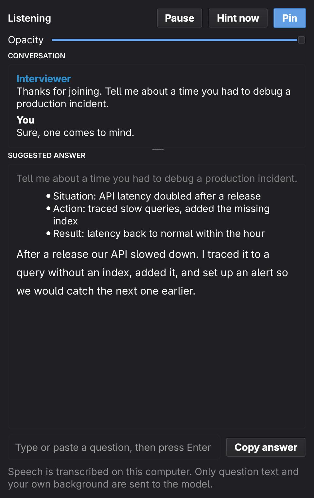
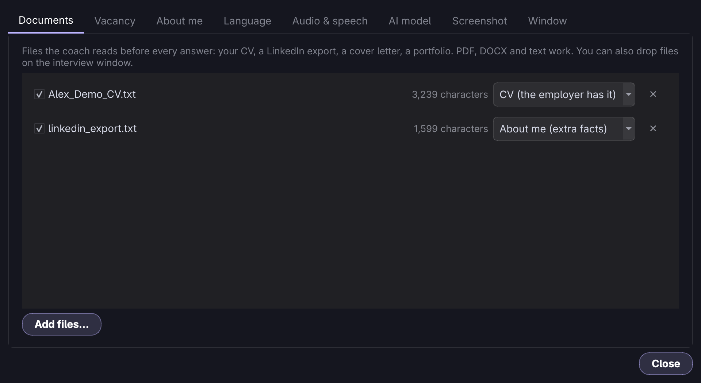

# Interview assistant

A compact window you keep next to Zoom, Meet or Teams. It listens to the call, and when the
interviewer says something it writes **what you should say**: short first-person lines you can
read out, built only from **your own** background (your `ABOUT.md`, your CV, the vacancy), in
the language of the interview.

<p align="center"></p>

For "hi" it gives the greeting itself, who you are and an invitation to start. For "What is
Python?" it explains: a one-sentence definition, the key properties, typical uses and the main
trade-off, with at most a closing line about your own experience. For "Do you have experience
with Kubernetes?" the first line says honestly that you do not, and the rest bridges to what you
really did. Nothing in it is advice such as "keep it short", and an earlier greeting is never
repeated. Typos and speech-recognition slips in the question ("pytohn") are read through.

## Use it fairly

Many employers forbid AI help during interviews, and recording a call can need the other
side's consent. Check the rules for each interview and tell the interviewer when you are
expected to. The window only suggests: you decide what to say.

On Windows 10 (version 2004+) and 11 the window sets `WDA_EXCLUDEFROMCAPTURE` on itself, its
menus and the Settings window, so Zoom, Teams, Meet, OBS and screenshots drop it from the
capture entirely while you keep seeing it on the monitor. Older Windows builds show a black
box instead; a physical camera or a photo of the screen is, of course, unaffected. On other
systems keep the window on a monitor you do not share.

## Speech recognition: Whisper or Deepgram

By default speech is recognised by Whisper on your computer: nothing leaves it, but a computer without a graphics
card needs a second or two per sentence. *Settings → Audio → Speech recognition → Deepgram* sends each
sentence of the call (and of your microphone, when it is on) to Deepgram instead, which is quick on any computer.
That means the voices leave the computer, so check that this is acceptable for the interview. The live captions send
the growing sentence again every 1.5 s, so the audio Deepgram bills is about three to four times the speech. A wrong
key or an empty account is reported once, in the window, not with every caption. The request and the error handling
are tested against a mock and the error replies were checked against the real service with a dummy key; a real key
has not been tried.

## Run it

```bash
./scripts/install.sh               # once: commands in ~/.local/bin and a launcher entry
switchyard                         # the language model gateway
careertwin-interview               # or open "CareerTwin Interview" from your launcher
```

The install is editable (it runs this checkout; re-run the script when dependencies change) and
`./scripts/uninstall.sh` removes it. Without installing, use `uv sync --extra interview` and
`uv run careertwin-interview`; the commands then live in the project's virtualenv, not on your
`PATH` (`source .venv/bin/activate`, or `activate.fish` in fish).

**Ready-made installers.** Each release on GitHub has a Windows setup program (`…-windows-x64-setup.exe`: it installs for the current user, adds a Start menu entry and keeps your `data` folder when you update or uninstall), the portable zip and a macOS disk image (`…-macos-arm64.dmg`, Apple silicon). Windows may warn that the publisher is unknown (More info, Run anyway) and the Mac refuses the first double click (right-click, Open): neither is signed. On a Mac the window, settings, typed questions, screenshots and project defense are meant to work, but call audio is not there yet, and nobody has tried that build by hand on a Mac. The release workflow installs the Windows setup and starts the Mac app on GitHub's own machines before it publishes.

**Windows.** `make windows` (or `./scripts/build_windows.sh`) builds a portable 64-bit folder and zip,
`dist/windows/CareerTwin-Interview-windows-x64.zip`, on Linux without Wine: uv fetches the Windows
wheels and the program runs on the python.org embeddable Python. Unzip it anywhere writable and start
*Start CareerTwin Interview.bat*; your data lives in its `data` folder. In this version the window,
settings, documents, typed questions, listening and screenshots work. The call is heard by recording
what the default output plays (WASAPI loopback through the `soundcard` package; pin another output in
*Settings → Audio*), and a screenshot copies the primary screen or all screens (GDI, no extra package).
Speech recognition runs on the CPU there. The build is checked under Wine only: the doctor runs, the
window renders, devices open and frames arrive at the right pace and the screen is read with the right
colours, but Wine plays no real sound into the recorder, so capture of an actual call has not been
tried on a real Windows machine: run *Check setup* there first.

**Everything is set up in the window.** Open ☰ → *Settings…* (or click the dim *Context* line
at the bottom). Changes apply at once and are saved, so the next start is already configured.
There is nothing to edit in files and no flag you need.

## One interview per vacancy

Each interview keeps its **own vacancy, the CV you sent for it and your notes**; `ABOUT.md` is
shared. Set one up in a minute:

1. ☰ → *Interview* → *New interview…* (or *New* at the top of Settings).
2. **Vacancy** tab: paste the vacancy text or a link, or pick it from the application pipeline
   (the CV prepared for it is attached automatically).
3. **Documents** tab: add the CV you sent for this vacancy (drop the file on the window or *Add
   files…*). Add anything else about you as *About me*.

The interview is named after the vacancy. Switch between interviews from ☰ → *Interview* or the
picker at the top of Settings; the vacancy, CV and notes change together, and the last one used
opens next time. The dim line at the bottom of the window shows which interview is active and what
it reads.

## Settings

<p align="center"></p>

| Tab | What you set |
|---|---|
| **Interview picker** (above the tabs) | Switch, create, rename or delete interviews. |
| **Interview** | One page for the active interview. *CV and documents*: add your CV, a LinkedIn export, a cover letter or any file about you (PDF, DOCX, text) with *Add files…* or by dropping them on the window; mark each as *CV (the employer has it)* or *About me (extra facts)*, switch it off without deleting it, or remove it (files are copied into `data/interview/documents/`; a blank or scanned PDF is refused with a reason). *Vacancy and notes*: pick a vacancy from the application pipeline (the CV prepared for it is attached too) or paste its text or a link, and add notes for this interview. |
| **About me** | Your `ABOUT.md`, editable in place and saved to the file. This is the main source of facts; write the *Interview stories (STAR)*, *Honest limits* and *Never claim* sections for the best answers. |
| **Practice** | Before the call. *Question bank* lists the questions this interviewer is likely to ask for the active interview, each with first-person lines to say: definitions are explained, and where you lack experience the first line says so plainly and the rest bridges to what you did. *Review my CV for this vacancy* compares the CV with the vacancy: a summary, the real strengths to lead with, gaps with an honest way to address each, the questions those gaps invite, and concrete fixes to the CV text. Results are kept per interview while the window is open. |
| **Project** | The project you will defend: *Choose folder…* reads it, the AI writes a dossier of it, and every answer about it comes from the dossier and the code that matches the question. You can edit the dossier and *Save changes*, *Analyze again* after the code changes, or *Remove* it. One project per interview. See *Defending a project* below. |
| **Audio** | Listen to the call on or off, the call audio source (*Automatic* follows the output that plays the call, or pin one), your microphone and the speech engine. *Whisper* runs on this computer (choose the model, `tiny` to `large-v3-turbo`; it uses the GPU when there is one and falls back to the CPU by itself); *Deepgram* is cloud recognition with an API key (also read from `DEEPGRAM_API_KEY`) and *Test the key*. |
| **AI** | The *Provider* (Switchyard, Groq, OpenAI, OpenRouter, Ollama, LM Studio, or your own address) and the model; *Load models* lists what the provider offers and *Test connection* checks it. A cloud provider also asks for its API key, *Other* for the address. Choosing another provider clears the key and the model, so a key is never sent to the wrong server. Cloud providers receive your CV, ABOUT text and each question. A local Switchyard needs nothing: leave the model on auto. |
| **General** | *Answers*: interview language (auto-detect or a fixed one), answer style (concise, standard, detailed), answer layout (main answer only, or lines plus the detailed answer) and whether to show the detailed answer. *Window*: window language, keep on top, frameless or framed, opacity, text size, the Screenshot button on or off, saving transcripts, and *Reset all settings*. |

Settings are stored in `data/interview/settings.json` (readable only by you; an API key you type
here is kept in that file) and your context in `data/interview/context.json`. Command-line flags
(`--language`, `--whisper`, `--model`, `--source`, `--mic`, `--text-only`, `--resume`, `--job`,
`--notes`, `--framed`, `--no-pin`) override the saved values for that run only; see
`careertwin-interview --help`.

## What it knows about you

Every hint is generated from the sources shown in the dim line at the bottom of the window:

- **`ABOUT.md`**, read whole, including the interview stories and honest limits. If it is too long,
  the least useful sections (*Applications log*, *CV files*, *Contact*) go first, never the tail.
- **Your documents** of the active interview, from the Documents tab. A document marked *CV* is treated as what the
  interviewer has read, so answers stay consistent with it; *About me* documents are extra facts.
  If a document and `ABOUT.md` disagree, `ABOUT.md` wins and the first line says so honestly.
- **The vacancy and your notes** of the active interview, from the Vacancy tab. With `--job <vacancy id>` the CV that was
  prepared for that vacancy is attached automatically.

With no context at all the window says so instead of guessing.

## Language

Answers are written in the **interview language**, whatever language the question, `ABOUT.md` or
your documents are in. Company names, technologies and job titles are never translated.

- *Auto-detect* (default): Whisper detects the language of each utterance and the window settles on
  the majority of the last few, so one stray sentence does not flip it.
- A fixed language (Settings → General) is used for speech
  recognition and answers, and can be changed during the call.

The window itself is translated into English, Russian, Polish, Ukrainian, German, French and Spanish
(*Settings → General → Window language*, or *Follow the interview*, which switches with the language
Whisper hears). Interviews can run in 33 languages; a language without a window translation shows
English labels. Adding a translation is one file: [TRANSLATING.md](TRANSLATING.md).

A spoken question has to be recognised as one before it is sent. The question words of English, Russian,
Polish, Ukrainian, German, French and Spanish are built in, so a question is heard even when Whisper
leaves out the question mark. For any other language a spoken sentence of five words or more, or one with
a question mark, is sent as a question; a pleasantry like "yes" is not. The Ask button (`Ctrl ↵`) answers
the last thing said in any language.

## The window

| Control | Does |
|---|---|
| ⏸ | Pause or resume listening |
| Dots | Live level of the call audio, so you can see it is heard; text while loading, thinking or on errors |
| **Ask** `Ctrl ↵` | Answer the last thing the interviewer said, even if it did not sound like a question |
| **Screenshot** `Ctrl ⇧ ↵` | Send the screen to a vision model: a coding task, a slide, a question on screen. The solution appears as lines to say and a code block. The window hides for the moment of the capture, only when it is on the monitor being captured |
| Input | Type or paste a question and press `Enter` |
| `Ctrl ←` `Ctrl →` | Page through earlier answers (`2/2`) |
| **Details** `Ctrl D` | Show or hide the detailed answer under the lines (lines layout) |
| ☰ | Settings, switch interview, transcript, quit |

**Main answer only** (Settings → General → Answer layout) skips everything else: the model
writes just one paragraph to read aloud and it starts at once, so it is also the fastest layout.

In the default *lines* layout the first thing you see is the lines to say, with key terms in bold; they stream in within a few
seconds. Under them the **detailed answer** follows as the rest arrives, in three parts: the *main
answer* (a paragraph), *key points* (a term in bold and one sentence each) and *practical context*
(where it is used, or how it applies to this vacancy and your real work). A technical question adds a
fourth part, the *likely next questions* with a one-sentence answer to each. It is on by default; the
**Details** button or `Ctrl D` hides it, and the *Concise* answer style skips it altogether for the
fastest replies. The window scrolls when the answer is long.
`Ctrl P` pauses. Questions are recognised automatically (debounced, split questions merged).

## Technical questions

A technical question (a concept, a design, a slow endpoint, a function to write) is answered in the shape that fits it,
chosen by the model from the wording, in any language:

| Question | The lines to say |
|---|---|
| Concept, "X vs Y" | the definition, how it works, when to use each, the main trade-off |
| "How would you design…" | the assumptions (scale, latency, consistency), the components and data flow, the key decision and its alternative, where it breaks and how you would measure it |
| "It is slow / broken" | reproduce and measure, form a hypothesis, narrow it down, fix the cause, prevent a repeat |
| "Write / implement…" | the approach, time and space complexity, edge cases; the code in the answer |
| "Why X rather than Y" | the criteria, the choice, what you give up |

What is said about the technology is general knowledge and is worded as such: the assistant does not claim that you
built, used or measured anything unless your `ABOUT.md` or CV says so, and the one line that ties the answer to you
only names a technology that is written there. When the model is unsure of a version or a detail it says so rather
than guess. The *likely next questions* in the detailed answer are what an interviewer usually asks after this one,
each with a one-sentence answer, so a follow-up does not catch you without a line to say.

A screenshot is answered by the kind of task it shows: a multiple-choice question gets the option and the reason, "what
does this print" the traced output, SQL one query, a bug the corrected code, a design question a few spoken sentences.
Model answers to a trap question can still be wrong, so read the result before you say it.

## Defending a project

For a defense of your own work (a thesis, a pet project, a commercial one) open *Settings → Project* and choose the project folder. The window then answers any question about it:

1. **Reading (a second or two).** The folder is read on this computer. With git, the files git would show are read (so `.gitignore` is respected); otherwise the folders `node_modules`, `venv`, `build` and the like are skipped. Binaries, lock files, files over 200 KB, `.env` files, keys (`*.pem`, `id_rsa`…) are left out, and anything that looks like a token or password inside a file is blanked before it goes anywhere. At most 4,000 files and 6 MB of text are read.
2. **The dossier (once, about a minute).** The AI gets the file tree, the READMEs and manifests and the most important code, and writes a dossier: overview, tech stack, architecture, key modules, how to run and test, decisions and trade-offs, weak spots, and twelve likely questions with short answers. It is shown in the tab. A reason the code does not state is marked *(inferred)*: edit those lines to say what you really thought, then *Save changes*.
3. **Every question.** The dossier goes with the question, and so do the few code excerpts that match it best, found by a keyword search over the project's own text (identifiers like `OrderService` also match "order" and "service"). The search takes about 0.5 ms for a small project and about 4 ms for the largest one it reads (6 MB of text), so it never delays the first words; an answer starts as quickly as any other.

Measured on a small FastAPI project with `ovhcloud/Qwen2.5-VL-72B-Instruct` through a local Switchyard: the analysis took 53 seconds, and questions such as "How do you calculate the order total with the discount?" had their first words after about one second and the whole answer after 8 to 10 seconds. The answer named the real `OrderService.total` and its 10 % loyalty discount from the code.

What to know:
- **Where the code goes.** To write the dossier the files are sent once to the AI provider you chose (a cloud provider asks first; a local one such as Ollama keeps everything on this computer), and the dossier goes with every question after that.
- **"Why" questions** are the weak spot: the code shows what was built, not why. A model may offer generic reasons; put the real ones into the dossier or the interview notes.
- **Search needs Latin words.** The excerpts are found by words from the question that appear in the code, so a question asked entirely in Russian or Polish finds none unless it names a class, a function or a technology; the dossier still answers it.

## Code in answers

Code is shown as code: in a shaded block, with its indentation, long lines wrapped, and syntax colours (Python, Java, JavaScript/TypeScript, C-like languages, SQL, shell); names and commands in `backticks` inside a sentence are monospace. For a coding question and for a screenshot the solution appears right under the lines to say, not behind *Details*. Copying an answer gives the code without the fences.

## Answering the screen fast

`Ctrl ⇧ ↵` only works while the interview window has the keyboard focus, and during a call the focus is on the page with the task. Two ways to press it from there:

- **Windows:** `Ctrl+Shift+Enter` is registered for the whole system when the window starts, so it works in any program (if another program already owns it, the window says so and the button still works).
- **Linux:** bind a key in your compositor to `careertwin-interview-ctl screenshot` (`careertwin-interview-ctl ask` answers the last question the same way). Use the key written on the Screenshot button, `Ctrl+Shift+Enter`, so the hint on the screen is true. In niri (a file of its own, included from `config.kdl`; use the full path to the command if `~/.local/bin` is not on niri's `PATH`):

  ```kdl
  binds {
      Ctrl+Shift+Return { spawn "careertwin-interview-ctl" "screenshot"; }
      Ctrl+Shift+KP_Enter { spawn "careertwin-interview-ctl" "screenshot"; }
  }
  ```

  That key then belongs to the compositor everywhere, so a program that uses `Ctrl+Shift+Enter` for itself no longer gets it.

  Under niri the command captures only the monitor that has the focus, so a task shown on one monitor is sent without the other half of a dual-monitor desktop.

What the window does to keep its own part short (measured on a 3840×1080 desktop with `grim`):

| Step | Before | Now |
|---|---|---|
| Capture and encode | 200 ms PNG, 1.8 MB | 30 ms JPEG, 0.5 MB (half of that for one monitor) |
| Waiting for the window to vanish | 250 ms | 60 ms, and none when the window is on another monitor |
| What the model reads first | a 4,000-character prompt, your whole CV and ABOUT, the conversation | 1,000 characters, and a one-line list of your main technologies |
| Connection | opened for every answer | kept open, and opened when the window starts |

The rest is the model, and it varies much more than anything the window can do. On this gateway the first words of a screenshot answer took 4 to 30 seconds on most free vision models, and about 1 to 2 seconds on `ovhcloud/Qwen2.5-VL-72B-Instruct`, with the whole solution (about 700 characters) in 6 to 9 seconds; one request in five stalled for over a minute. So pick a fast model in *Settings → AI → Model for screenshots*; the window shows how long the last one took when you hover the status dots. Two seconds is realistic for the first lines, not for a long solution.

## How it works

```
call audio (sink monitor) ─► 20 ms frames ─► utterance segmenter ─► local Whisper (+ language)
                                                                          │ text
                             is it a question? ─► debounce ─► streaming coach ─► Switchyard (SSE)
                                                                          │ tokens
          ABOUT.md · documents · vacancy · last turns · interview language ┘
```

- **It does not wait for the end of the question.** While the interviewer speaks, a caption line (🎧)
  shows the words heard so far and refreshes about every 1.5 s. The question counts as finished after
  half a second of silence, and the request to the model leaves 0.4 s later (so a question split by a
  short pause is still sent as one). A long monologue is cut into pieces of at most 12 s instead of
  one 25 s block, and a caption that already covers the speech is used as the final text.
- **Audio stays local.** `parec` reads the sink monitor; faster-whisper transcribes on your
  machine (CPU, or GPU when its CUDA libraries load). Recognition is primed with your skills and
  the vacancy so names like Kubernetes are heard correctly.
- **Only text leaves the machine:** the question, recent turns, your context and documents, and
  screenshots you send go to the model through Switchyard.
- **Answers stick to your facts.** The prompt forbids inventing employers, dates, numbers or skills.
- **Salary follows your policy** from the Studio. In `auto` mode it never states a number you did
  not choose.
- **Transcripts** are saved to `data/interviews/` when you close the window (switch off in
  Settings → General). Audio is never stored.

## Window managers

The window is frameless and translucent; drag it by the empty parts of the header and resize by dragging
its border (or turn *Frameless window* off). Qt sets the app id to `careertwin-interview`, so
you can float it. In niri (25.01 or later):

```kdl
window-rule {
    match app-id="careertwin-interview"
    open-floating true
    default-column-width { fixed 920; }
    default-window-height { fixed 400; }
}
```

Without such a rule a tiling compositor gives it a full tile, which the layout handles. Under
Wayland, *keep on top* is the compositor's call; `careertwin-interview --xcb` runs the window
through XWayland where the hint is honoured.

## Practice before the call

The Prepare tab does this in the window. The same coach is available to agents and over HTTP:

```bash
curl -s localhost:8000/v1/interview/cv-review -H "Authorization: Bearer $(cat data/api-token)" -H 'content-type: application/json' \
  -d '{"job_id": "<vacancy id>", "language": "en"}'   # needs the vacancy's prepared CV
curl -s localhost:8000/v1/interview/practice -H "Authorization: Bearer $(cat data/api-token)" -H 'content-type: application/json' \
  -d '{"job_id": "<vacancy id>", "count": 8, "language": "ru"}'
curl -s localhost:8000/v1/interview/suggest -H "Authorization: Bearer $(cat data/api-token)" -H 'content-type: application/json' \
  -d '{"question": "Tell me about a time you debugged production.", "language": "en"}'
```

In an agent session use `prepare_interview_questions` and `suggest_interview_answer` (see
[AGENTS.md](AGENTS.md)).

## Troubleshooting

- **No transcript:** watch the dots; if they stay dark, hover the dots to see which output the app
  listens to. *Automatic* (the default) follows the output that is playing, so plugging in a headset
  or starting the call on another output is picked up within a few seconds. If it still hears
  nothing, pin the right output in Settings → Audio (*Refresh* after joining a call).
- **Something failed:** the reason is written out in red above the answer (the status dots are too narrow for it), and every screenshot step and error is kept in `data/interview/interview.log`, because the launcher starts the program without a console. An orange line with scissors means the model ran out of room and the answer stops early: ask again, or pick a model with longer answers.
- **The screenshot key does nothing in other windows:** `Ctrl+Shift+Enter` works only inside the interview window until the compositor binds it (see *Answering the screen fast*). `careertwin-interview-ctl screenshot` in a terminal tells you whether the window is running.
- **Screenshot is greyed out:** install `grim` (Wayland) or `spectacle`, or `maim`/`scrot` on X11,
  and check Settings → General.
- **A document is refused:** the PDF has no text layer. Export a text PDF or attach DOCX.
- **Speech turns into text slowly:** on a CPU one Whisper pass takes about 0.8 s whatever the length of the
  question, so the delay you feel is the silence wait plus the model. With an NVIDIA GPU the installer adds
  the CUDA 12 libraries (about 1.3 GB; `CAREERTWIN_NO_GPU=1 ./scripts/install.sh` skips them) and Whisper
  runs on the GPU in half precision: on an RTX 4050 a pass dropped from 0.8 s to 0.35 s, and the text of a
  9-second question was ready about 1 s after the speech ended (1.9 s on the CPU). The device is `whisper_device` in `data/interview/settings.json`
  (`auto`, `cpu` or `cuda`); if the GPU fails to start the app falls back to the CPU by itself.
- **Answers are slow:** the model matters most. Settings → AI → *Load models*; in a test with a
  realistic prompt `groq/openai/gpt-oss-120b` finished in about 1–4 s and `kilo/poolside/laguna-s-2.1:free` showed
  its first words in about 2 s, while `auto` varied from 1 s to 40 s. If the chosen model fails before saying
  anything (rate limit, outage), the request is repeated once on `auto`. Answers also get faster with the
  *Concise* style and a smaller `ABOUT.md`; sections that never help answer (the applications log, CV file
  names, job-ad matching rules, the project catalogue) are already left out of every request.
- **First start is slow:** Whisper downloads its model once and loads it before listening starts;
  the status pill says so.
- **`libcublas` errors:** the app already falls back to CPU. For a GPU, install the CUDA 12 runtime
  libraries.
- **The launcher shows a generic gear icon:** the launcher cached its icon folders before the install
  created `~/.local/share/icons`. The desktop entry uses an absolute icon path to avoid this; if an old
  entry is still shown, restart the launcher or shell (for Noctalia, restart `qs`).
- **Check the setup without the window:** `uv run careertwin-interview --doctor`.
