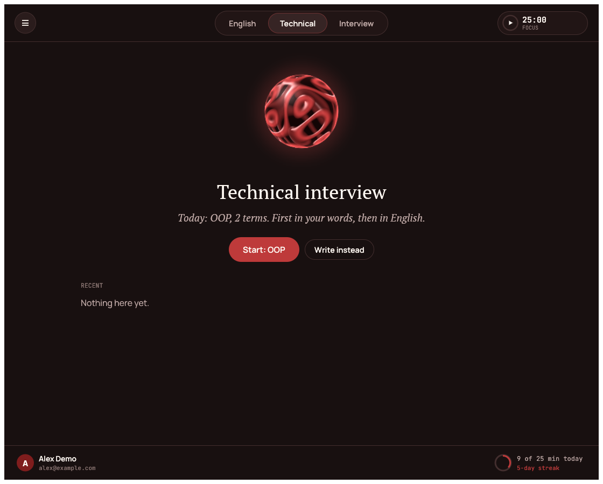
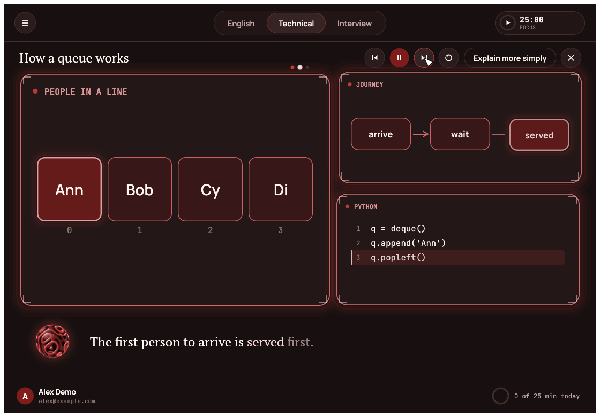
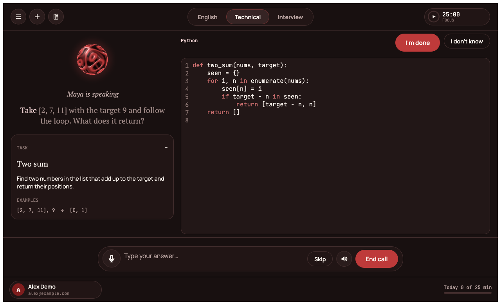
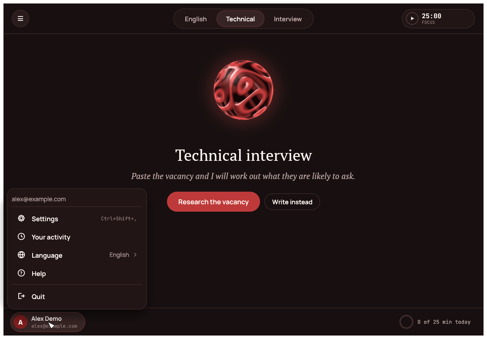
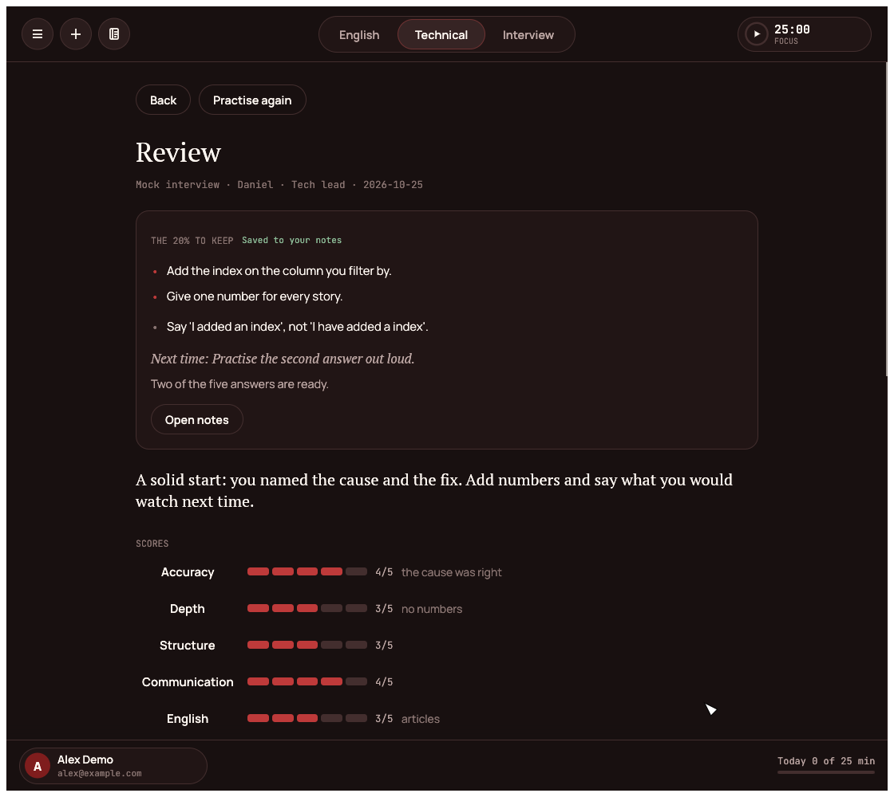

# CareerTwin Prep

A separate program, written in Rust, for preparing for interviews **out loud**, as a conversation with a tutor who talks
like a person. It is not part of the interview overlay: the overlay helps during a real call, Prep is where you train
for it.

Every part looks the same: a glowing sphere in the middle that moves with the voice, what the tutor says written under
it word by word as it is spoken, and a bar at the bottom to talk or type. A pill of three tabs sits at the top.

| Tab | What it is for |
|---|---|
| **English** | A relaxed spoken conversation at your level (A2 to C1). The partner repeats your mistakes back correctly inside its own sentences, as a person would, and does not stop you to correct. *Say it in English*: say a thought in Russian, hear it in natural English in three registers, say it back and see which words went missing. Phrases from your reviews come back just before you forget them. |
| **Technical** | **Your plan** for the vacancy, a **terms lesson** (first in your own language, then in English), **live coding**, a spoken **mock interview**, **concept checks** and **pictures**: any topic told as a short animated story. |
| **Interview** | **Your introduction** coached until it is short, true and yours, a recruiter or hiring-manager **mock interview**, and *Prepare for a vacancy*: your CV against the vacancy, the gaps and how to answer them, and the questions it invites. |

Under every tab, **Write instead** opens a quiet chat with the same tutor: nothing is spoken, so it works in a lecture. A
good answer becomes a note.

Every call ends with a **review**: scores, what to work on, each answer with what went well and what to fix, a better
answer you can listen to and say yourself, language notes and phrases to keep, and **the 20% to keep**: the few lines
that matter, saved to your notes.

<p align="center"></p>

## The plan: 80/20 for your vacancy

Paste the vacancy and the program works out what you are likely to be asked. It ranks the topics (object-oriented
programming, REST, SQL and so on) by how likely each is and by how much work it takes, keeps the few that hold **80% of
the likely questions**, and writes every term of those in plain words, in your language, with an everyday comparison and
a good spoken answer in English. Everything on the plan says how much of the likely questions you already cover.

It is the model's knowledge of what interviews for such a role usually ask, shaped by the text of the vacancy and your
`ABOUT.md`; it does not search the web, and it knows nothing about the company beyond what the vacancy says. A vacancy
that has changed since the plan was made is noticed.

## The terms lesson

For each term the tutor goes through two stages:

1. **In your own language.** It asks what the term means. If you are right, it says so and moves on. If you are partly
   right, it fixes the rest in plain words with the comparison. If you say you do not know, it does not hand over the
   answer: it asks a small question that leads one step, or gives the comparison, and lets you say it.
2. **In English**, as in the interview. It accepts imperfect English and repeats the correct form inside its own reply
   instead of pointing at the mistake, then asks the follow-up an interviewer would ask.

Each half is scored 0 to 3 by the tutor; what you know is kept, and the plan's coverage moves. The lesson is a focus
block: starting it starts the timer. The main button on the Technical tab always offers the next topic of the plan, and
once every term is learned it becomes **live coding**.

The language you practise (English by default) is a setting; German, Spanish, French, Italian or Polish work in the same
way. The English tab stays English, and the offline voice speaks English only.

## Pictures

Ask the tutor to show or draw something (or choose *Explain with pictures* and type a topic) and it is told as a short
animated story for a complete beginner: floating glowing panels around the sphere, which narrates in the corner while
the words light up. There are eight kinds of picture (boxes with arrows, a row of cells, a little code with the line that
matters lit, two things side by side, numbered steps, "this is like that", layers, and plain text). Items come in as
they are said, and a panel that continues from one scene to the next grows instead of appearing again.

You can pause, skip, go back, replay, close it, or ask for a simpler version. Speaking over it pauses it; when it ends,
the tutor asks one question to see whether it landed.

<p align="center"></p>

## Live coding

You get a task for the vacancy, in the language you choose, with the solution idea, the mistakes to look for and
three nudges kept **for the tutor only**. You write in an editor while the tutor, at the side, lets you think.

- When the code has been still for a few seconds, the tutor looks at it. **On the right track, it says nothing.**
- If something is wrong it never names the line or the fix. It asks you to check: *"Take [2, 7, 11] with the target 9 and
  follow the loop; what does it return?"* If you stay stuck it points at the area, never at the answer.
- If you are stuck, you get a nudge as a question, from the vague ones to the specific.
- If you say you do not know, you work it out **together**, one small step at a time, and you type every change.
- When you say you are done, it asks you to try a tricky input and for the complexity.

It also watches for what you would not be allowed to do in a real interview: a block that arrives all at once instead of
being typed, or the window left for a long time followed by a finished solution. It does not accuse; it asks you to walk
it through that part in your own words. **It sees only this program's window**: it cannot see other windows or the
screen, and it does not try to. The review is told what it saw.

<p align="center"></p>

## Notes, the focus timer and your numbers

- **Notes** (the notebook at the top left): short, one idea each. After every call the tutor keeps the few lines worth
  remembering and the slips to avoid; in a chat, an answer worth keeping is saved on its own; you can add your own, star
  the ones that matter, and copy everything as Markdown.
- **Focus timer** (top right): a Pomodoro of 25 minutes of work and 5 of rest, a long rest after four blocks, with a soft
  chime. The lengths are in Settings. When a block ends during a call, the tutor is told and suggests a break at the next
  natural pause. `Ctrl+Shift+T` starts or pauses it.
- **The panel at the bottom** shows your name and address, and how today is going against your goal; its menu has
  Settings (`Ctrl+Shift+,`), Usage, Language, Help and Quit. **Usage** shows today, the week and the total, and the
  streak.

<p align="center"></p>

## Run it

```bash
./scripts/install-prep.sh          # builds with offline hearing and voice (needs Rust and the ALSA headers)
LIGHT=1 ./scripts/install-prep.sh  # smaller build that uses cloud or server engines only
careertwin-prep --doctor           # checks the model, recognition, voice, microphone and speakers
careertwin-prep
```

Settings are in the menu at the bottom left of the window. Nothing is needed in a file, but a key can also come from its usual
environment variable (`GROQ_API_KEY`, `OPENAI_API_KEY`, `ELEVENLABS_API_KEY`, `SWITCHYARD_API_KEY`), so a key never has
to be typed anywhere.

<p align="center"></p>

## How it talks like a person

The call is one loop (`prep/src/conversation.rs`) and each behaviour has a test that runs a whole call on a paused clock.

- **It starts speaking before it has finished writing.** The model streams its reply, the reply is cut into sentences,
  and each sentence is voiced as soon as it is complete, while the next is still being written.
- **It waits for the end of a thought.** If what you said ends in "and", "so", "um" or a comma, it waits a moment for
  the rest and joins the two parts into one answer.
- **It acknowledges you when it needs a moment.** If the model is slow, a short "Mm-hm" is played first, never after
  the real answer has started.
- **It nudges you when you go quiet.** "Take your time" after 14 seconds, an offer to repeat the question after 40,
  and after a minute a simpler question.
- **You can talk over it.** With headphones on, speech over the interviewer stops it at once, and only what was
  really said goes into the history. On speakers the microphone is shut while it talks, so it never answers its own voice.
- **It watches the clock.** Near the end it asks whether you have questions; when time is up the answer is the goodbye.
- **It does not mistake noise for an answer.** "Thank you." from a cough, or a click, is dropped.

The interviewer only says what the context allows: facts about you come from your `ABOUT.md` and CV and nowhere else,
facts about the company only from the vacancy text, and where the profile has an honest limit ("no production
Kubernetes") it asks about the gap instead of letting you claim it.

## Engines: cloud, your own server, or offline

Three things are chosen separately: the **language model** (the interviewer's mind), **recognition** (hearing you) and
the **voice**.

| | Cloud | Your own server | Inside this program (offline) |
|---|---|---|---|
| Language model | Groq, OpenAI, OpenRouter | Switchyard, Ollama, LM Studio, a llama.cpp server | runs in Ollama or LM Studio; this program talks to it |
| Recognition | Groq (`whisper-large-v3-turbo`), OpenAI | any server with `/v1/audio/transcriptions` | **Whisper** through whisper.cpp |
| Voice | OpenAI (`gpt-4o-mini-tts` takes a tone instruction), ElevenLabs | any server with `/v1/audio/speech`, such as Kokoro, Chatterbox or Qwen3-TTS wrapped in one | **Kokoro-82M** in pure Rust, English |

Cloud engines receive what they speak or hear. Pointing an engine at `http://127.0.0.1:...` keeps it on this computer,
and an address that would send a key in the clear to another machine is refused.

### Offline

Build with the default `local` feature of the installer, then in Settings choose *In this program (offline)* for
recognition and for the voice. The program downloads the models on first use. Every file has its size and SHA-256
written in the program (`prep/src/models.rs`) and is checked before it is used, and the Kokoro files are pinned to one
commit of their repository.

What fits where (the program detects the memory and the cores and suggests):

| Memory | Hearing | Interviewer (in Ollama) |
|---|---|---|
| 2-3 GB | Whisper tiny (32 MB) | too small to hold an interview |
| 4-7 GB | Whisper base (60 MB) | `gemma3:1b` is the most that fits and is weak: use a cloud model for the interviewer |
| 8-15 GB | Whisper small (190 MB) | `gemma3:4b` |
| 16 GB and a GPU or 8+ cores | Whisper large-v3-turbo (574 MB) | `gemma3:12b` |
| 28 GB and up | the same | `gemma3:27b` |

A model that follows a spoken conversation and asks real follow-ups needs about four billion parameters at least.

Measured on a 12-core laptop CPU, release build, GPU not used (`cargo test --release --features local --test local_models`):

| | Time | What it means |
|---|---|---|
| Hearing, Whisper small, a four-second phrase | 0.65 to 0.7 s | a short answer is understood before you notice; a 20-second one takes a few seconds |
| Voice, Kokoro, four seconds of speech | about 3 s (0.77 times real time) | the first sentence of a reply comes after about three seconds, and the next ones keep up |
| Round trip: the voice says a sentence, the ear hears it | 100% of the words | |

The program makes Whisper read only as much audio as the clip needs, which made short answers about four times faster
than reading a full 30-second window. On a CPU with fewer cores than that the voice can fall behind real time; then use
a cloud or server voice and keep hearing offline. Both engines run on the CPU. A GPU build is not wired up yet: the dependencies have a `cuda` feature, but this
program does not enable it.

The offline voice speaks English. For Russian prompts and explanations use a voice server or a cloud voice, or turn
the Russian voice off: the interviewer then writes those parts.

## Privacy

- The settings file is written readable only by you (mode `0600`), in a folder that only you can enter.
- A key is never printed, logged or shown: it appears as `***` in any text the program makes, including error messages
  and `--doctor`.
- Sessions, the review deck and cached voice clips are private files in `~/.local/share/careertwin-prep` and
  `~/.cache/careertwin-prep`. Delete a session from the list and its file is gone.
- Your `ABOUT.md` and CV are read from where you point to and are sent only to the language model you chose.

## Checking and troubleshooting

`careertwin-prep --doctor` tells you which piece is wrong and what to do:

```
ok   profile                ABOUT.md · 1.5k
ok   language model         http://127.0.0.1:3260 answers, 319 models, using auto
FAIL recognition            Speech recognition returned 401: ... (check the recognition key in Settings)
ok   microphone             Default Audio Device, level 424
```

`--no-devices` leaves the microphone and speakers alone; `--no-probes` does not ask the recogniser and the voice for a
sample.

## Development

```bash
cd prep
cargo test                          # 450+ tests; none needs a sound card or the network
cargo test --features local         # also builds whisper.cpp and the candle voices (needs cmake)
UI_SHOTS=/tmp/shots cargo test --test ui_shots   # writes a PNG of every screen
cargo test --test hardware -- --ignored --nocapture      # the real microphone and speakers
cargo test --test live_llm -- --ignored --nocapture      # the interviewer, the tutor, the pictures and the coding tutor on a real model, with the demo profile
cargo test --release --features local --test local_models -- --ignored --nocapture   # the offline voice and ear
```

The window is egui. The sphere and the floating panels are painted by the program itself (the sphere pixel by pixel on
the CPU), so they look the same everywhere and are checked in tests. Fonts are PT Serif, Manrope and JetBrains Mono (SIL Open Font License, in `prep/assets/fonts`).
